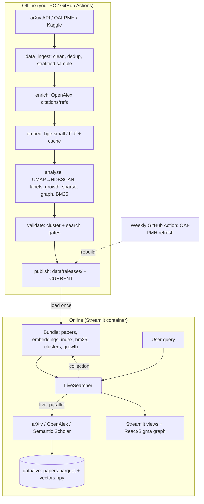

# ScholarGrid — Refactoring & Implementation Plan

**Status:** Option A approved and implemented (2026-10-18). Served release: `2026.10.18.2`. See [Implementation status](#implementation-status) below; the rest of the document is the original plan.

### Implementation status

| Task | Result |
|---|---|
| REF-01 corpus | Done. The 1,275-paper / 8-day release was a stale quick build; the cached harvest already covered 2023-01 → 2026-10. Two real defects were fixed on the way: (1) OpenAlex results were keyed by canonical DOI, so works OpenAlex had merged with their published version (publisher DOI) were silently dropped; they are now mapped back via every location, and cached records refetch once (`_REC_VERSION`). (2) `cluster.min_cluster_size: 15` was calibrated for ~1k papers; at 48k it gave 604 areas and 0 reliable trends, so it is now `auto` (0.3% of the corpus, benchmarked against 0.08–0.4% and `eom`). New release: 48,015 papers, 45 months, 77 areas, 20,973 with citations (was 1), 14,030 with references (was 0), 12,444 coupling edges, 39 areas with a reliable growth signal (was 0), ARI 0.71. |
| REF-02 revision pin | Done. `bge-small-en-v1.5@5c38ec7c…` pinned in `config.yaml` (inherited by production/refresh/deploy) and baked by the Dockerfile (`EMBED_REVISION`); tested. |
| REF-03 citation gating | Done. `ui.citations_ready` / `velocity_ready` (≥10% coverage) hide citation sorts, the min-citations filter and the boost toggle on citation-poor corpora. |
| REF-04 judgments | Tooling done: `judgments export --sample N`, report and history split judged vs heuristic and label search gates "(heuristic grades)". **Open:** hand-grade `reports/judgments_todo.csv` (15 queries) and set a judged baseline. |
| REF-05 live vs analyzed | Done. Results note, chip tooltip and About copy; "collection grows with use" removed. |
| REF-06 startup check | Done. `artifacts.embedder_mismatch` compares fingerprints and re-embeds 3 stored papers (cosine ≥ 0.98); a mismatch falls back to BM25 with the existing banner. |
| REF-07 CSV | Done. `release.write_csv: false` by default; CSV read fallback kept for old bundles. |
| REF-08 leads | Done. "Leads (experimental)" in the More menu plus a caveat on the page. |
| REF-09 DuckDB | Done. Docs updated; `python -m scholargrid.storage prune` added. Also fixed: a missing DuckDB file was recreated holding only the next upsert batch; it is now rebuilt from the Parquet layer. |
| REF-10 edge types | Done. Edges carry an optional 4th element (shared references); the detail pane says "shares N references". Old 3-element bundles still work. |
| REF-11, REF-12 | Deferred (optional). |
| Known remaining | Noise fraction 0.43 (advisory gate 0.35); `quality_checks` failed only on the intended row-count jump vs. the 1,275-paper release; ~1,900 papers kept pre-fix OpenAlex records because OpenAlex rate-limited the run (set `OPENALEX_MAILTO`; they refresh on the next enrich). |

**Audit basis:** Direct inspection of the repository at branch `main` (commit `cc57e7a`), plus the actual generated artifacts in `data/releases/2026.10.10.4/` and `data/live/`. Figures labelled **Measured** come from `meta.json` of that release; **Verified** means read directly from source; **Inferred** needs a benchmark or run to confirm; **Optional** is a possible improvement, not currently necessary.

**One-line verdict:** The architecture is fundamentally sound and should be *kept and optimized* (Option A), not rewritten. The project's biggest lever is **data/corpus quality**, not algorithmic sophistication — the current release spans only ~8 days and has almost no citation/reference data, which silently disables Trends, citation ranking, and graph coupling. Fix the corpus and a handful of correctness/deployment issues; keep the ML foundations.

---


## Table of contents

1. [Executive Verdict](#1-executive-verdict)
2. [Current Architecture](#2-current-architecture)
3. [Verified Problems](#3-verified-problems)
4. [Hypotheses That Were Not Confirmed](#4-hypotheses-that-were-not-confirmed)
5. [Components to Preserve](#5-components-to-preserve)
6. [Components to Simplify](#6-components-to-simplify)
7. [Components to Replace or Remove](#7-components-to-replace-or-remove)
8. [ML Architecture Assessment](#8-ml-architecture-assessment)
9. [Architecture Alternatives](#9-architecture-alternatives)
10. [Recommended Target Architecture](#10-recommended-target-architecture)
11. [Free Deployment Strategy](#11-free-deployment-strategy)
12. [Detailed Refactoring Tasks](#12-detailed-refactoring-tasks)
13. [Phased Migration Roadmap](#13-phased-migration-roadmap)
14. [Regression and Quality Validation](#14-regression-and-quality-validation)
15. [Complexity Reduction Summary](#15-complexity-reduction-summary)
16. [Risks and Unresolved Questions](#16-risks-and-unresolved-questions)
17. [Final Implementation Checklist](#17-final-implementation-checklist)
18. [Decisions Requiring Approval](#18-decisions-requiring-approval)

---


## 1. Executive Verdict

ScholarGrid is a **well-engineered offline-first system** that already implements the architecture the earlier docs describe. The offline/online split is real and clean: the pipeline (`scholargrid/pipeline.py`) does all heavy work and writes a versioned bundle; the app (`app/streamlit_app.py`) only loads the bundle and does query embedding + retrieval. This is the correct separation for a zero-cost, low-maintenance research tool and **must be preserved**.

The code is **not** broadly overengineered. Nearly every "sophisticated" layer earns its place: hybrid dense+BM25 retrieval, two-section (exact/related) results, acronym expansion, cluster-ID stability across refreshes, bootstrap CIs with reliability gates, and a bounded React graph payload. The complexity that *is* unjustified is narrow and specific (listed in §6–§7).

The genuinely important findings are about **data and a few correctness/deployment edges**, not algorithms:

- **(Measured)** The served release holds **1,275 papers spanning 0.2 months** (2026-09-25 → 2026-10-02), with **1 paper having citation data and 0 with references**. That silently neuters Trends, citation-velocity ranking, "most cited" sort, and the graph's bibliographic-coupling boost. The sophisticated growth statistics are correct but have no data to run on.
- **(Verified)** On the free deployment target (Hugging Face Spaces), the live-search store under `data/live/` is on ephemeral disk and is lost on every restart. The local store already holds **894 accumulated live papers** — exactly the data that would vanish in production.
- **(Verified)** Search quality gates (`validation.gates.search_ndcg_at_10: 0.75`) are evaluated against **heuristic** relevance labels; `configs/search_judgments.json` is empty (`"judgments": {}`). The gate numbers are therefore self-referential, not human-validated.
- **(Verified)** The served release was built with `all-MiniLM-L6-v2` while the config now specifies `BAAI/bge-small-en-v1.5`. Both are 384-dim, so they load, but a query embedded with the wrong model prefix/semantics degrades retrieval silently (the Docker/deploy docs already warn about this mismatch).

**Recommendation:** Adopt **Option A (optimize the existing architecture)**. Spend effort on corpus quality, the live/analyzed-data distinction, honest search evaluation, and trimming a few dead code paths — not on a frontend rewrite or a static-first migration.

---


## 2. Current Architecture


### 2.1 Offline pipeline (`scholargrid/pipeline.py`)

Six stages, each cached to `data/stages/` so any stage can resume:

`ingest → enrich → embed → analyze → validate → publish`

`analyze` internally runs: build NN index → analytical reduce (UMAP→8d) → cluster (HDBSCAN) → match cluster IDs to previous release → stability (ARI) → c-TF-IDF labels → 2D projection (separate UMAP) → growth → sparse leads → similarity graph → BM25 → phrase/acronym indexes → write bundle.

### 2.2 Online app (`app/`)

Streamlit multi-page shell (`streamlit_app.py` → `ui.py` → `views/*.py`) plus one React/Sigma.js custom component (`app/components/explorer/`). The app loads the bundle once (cached with `@st.cache_resource`), embeds queries, and retrieves. Every search also fetches live from arXiv/OpenAlex/Semantic Scholar (`scholargrid/live_search.py`) and persists new papers to `data/live/` (`scholargrid/live_store.py`).

### 2.3 Data flow




### 2.4 Storage inventory (Verified)


| Artifact                                      | Format                          | Purpose                                     |
| --------------------------------------------- | ------------------------------- | ------------------------------------------- |
| `papers.parquet` / `papers.csv`               | Parquet (+ CSV ≤20k rows)       | Paper metadata + cluster_id + 2D coords     |
| `embeddings.npy`                              | float16/32 npy (mmap if >512MB) | Dense vectors                               |
| `reduced.npy`                                 | float32 npy                     | 8-D analytical reduction (clustering input) |
| `clusters.json`, `growth.json`, `sparse.json` | JSON                            | Cluster meta, growth stats, leads           |
| `edges.json`, `neighbors.json`                | JSON                            | Graph edges + per-paper neighbours          |
| `bm25_tf.npz` + `bm25_meta.json`              | scipy sparse + JSON             | Lexical index                               |
| `ann.faiss`                                   | FAISS (only if corpus ≥ 20k)    | ANN index                                   |
| `embedder/`                                   | JSON meta (+ joblib for tfidf)  | Query embedder config                       |
| `data/live/`                                  | Parquet + npy + JSON            | Live-discovered papers (ephemeral in prod)  |
| `data/scholargrid.duckdb`                     | DuckDB (667 MB locally)         | Raw harvest working store (offline only)    |


### 2.5 Key configuration facts (Verified)

- Single YAML with `extends:` inheritance: `config.yaml` → `production.yaml` → `refresh.yaml`; `deploy.yaml` is what the container serves. Validated by `scholargrid/schema.py` (pydantic).
- Backends resolve `auto` → preferred lib if importable, else deterministic sklearn fallback (`config.py`): embedding `minilm|tfidf`, reduce `umap|pca`, cluster `hdbscan|dbscan|kmeans`, index `faiss_hnsw|exact`, storage `duckdb|parquet`.
- `search.live: true` is on by default and **not** overridden in `deploy.yaml`, so production fetches external sources on every query.

---


## 3. Verified Problems

Each is confirmed from source or the generated release. Priorities: P0 (correctness/deployment blocker), P1 (high-value), P2 (useful), P3 (defer/avoid).

### P0-1 — Live-discovered papers are lost on restart in the zero-cost deployment

**Evidence:** `live_store.py` persists to `cfg.live_dir` (`data/live/`). `Docs/deployment.md` §4B.6 states the HF Spaces disk resets on restart; the local store already holds 894 papers (`data/live/meta.json: "n": 894`). On the only free option, every restart discards accumulated discoveries. **Impact:** the "collection grows with use" promise does not hold on free hosting. This is tolerable *if* communicated and if live papers are never confused with the analyzed landscape — see P0-3.

### P0-2 — Served embedding model can silently mismatch the configured model

**Evidence:** `meta.json: "embedding_model": "all-MiniLM-L6-v2@latest"` but `config.yaml embedding.model_name: BAAI/bge-small-en-v1.5` with a `query_prefix`. `embeddings.py::Embedder.load` reads the prefix *from the bundle*, so a correctly built bundle is self-consistent — but the Docker image bakes a model via `--build-arg EMBED_MODEL` that must match the release, and nothing enforces it at startup. A mismatch degrades retrieval with only a log warning. **Impact:** silent relevance degradation in production.

### P0-3 — Live papers vs analyzed landscape: mostly handled, one gap

**Evidence (good):** live results carry `is_new: true`, `cluster_id: None`, `bundle_index: None`, and the UI shows a "New · found online" chip (`ui.py::paper_card`, `home.py`). They are correctly excluded from the graph/areas/trends (those read only `bundle.df`). **Gap:** live papers are **never fed back into the next offline build** — the weekly refresh (`refresh.yaml`, OAI-PMH) harvests independently and ignores `data/live/`. So a paper a user "discovered" may never enter the analyzed corpus. This is defensible by design but should be explicit, and optionally closed (REF-11).

### P1-1 — Trends/growth and citation features run on data that cannot support them

**Evidence (Measured):** release spans `span_months: 0.2`; `with_citations: 1`, `with_references: 0`, `growth.n_reliable: 0`, `growth.sufficient_history: false`. The growth gate needs 24 months. So: Trends shows nothing reliable (correctly gated off via `ui.growth_ready`), "most cited"/"citation velocity" sorts are meaningless, and the graph's `coupling_boost` never fires (needs references). **Impact:** three advertised capabilities are effectively dark. This is a **data** problem, not a code problem — the code degrades gracefully. Fixing the corpus (REF-01) lights them up.

### P1-2 — Search quality gates are validated against heuristic labels only

**Evidence:** `configs/search_judgments.json` = `{"judgments": {}}`. `validation.py` falls back to heuristic grades (expected category +1, expected keyword +1). The gate `search_ndcg_at_10 >= 0.75` therefore measures "does retrieval return papers in the expected arXiv categories containing the expected keywords," not human relevance. **Impact:** the headline quality number is circular; retrieval changes cannot be honestly compared. (Prompt §11 explicitly warns against relying solely on self-generated labels.)

### P1-3 — `data/scholargrid.duckdb` is a 667 MB working store that is easy to confuse with a serving artifact

**Evidence:** 667 MB file at repo root under `data/`; `production.yaml storage.backend: duckdb`. It is a *raw-harvest* store used offline (`data_ingest.py`/`storage.py`), not needed by the app, and is gitignored. **Impact:** disk bloat and confusion; harmless if understood, but worth documenting/trimming in the offline workflow.

### P2-1 — Two separate UMAP reductions dominate offline cost and are hard to interpret

**Evidence (Measured):** `reduce` (UMAP→8d) = 23.1s, `project` (UMAP→2d) = 2.45s, `sparse` (re-projects 3×) = 5.85s, out of ~1 min total for 1,275 papers; UMAP is the single largest cost and scales super-linearly. Two independent UMAP fits mean cluster structure (8d) and the visual map (2d) can disagree. This is a deliberate choice (docs: "never use 2D as the analytical basis") and is **justified**, but is the main simplification candidate if offline time becomes a constraint at 50k+.

### P2-2 — `papers.csv` is written as a redundant copy of `papers.parquet`

**Evidence:** `artifacts.py::save_bundle` writes both when `len ≤ 20000` (drops only `references`). The app reads Parquet; CSV is convenience only. **Impact:** minor disk/time duplication.

### P2-3 — Sparse-neighborhood leads depend heavily on projection/sampling parameters

**Evidence:** `sparse.py` gates on `min_corpus_size` (dev 1000, prod 20000), re-projects under seeds, and labels output "not a proven research gap." On the dev corpus it produced 12 leads from 1,275 papers — on a corpus spanning 8 days these are almost certainly sampling noise. The feature is honestly labelled but its value for beginners is unproven. **Impact:** possible user confusion; low cost to keep behind the existing gate.

---


## 4. Hypotheses That Were Not Confirmed

These concerns from the brief were investigated and found **not** to require change:

- **"Expensive ML runs on user requests."** *Not confirmed.* The app only embeds the query and does dot-products; `ui.py` caches config, bundle, and searcher with `@st.cache_resource`. Live embedding is bounded (`live_embed_max: 300`, `live_embed_budget_s: 4`). The offline/online split holds.
- **"Artifacts repeatedly loaded/reconstructed."** *Not confirmed.* `_load_bundle` is `max_entries=1` and keyed by a release mtime probe (`_release_key`, 20s TTL) so it reloads only when a new release is published. Embeddings are memory-mapped above 512 MB.
- **"Custom BM25 is unreliable."** *Not confirmed.* `bm25.py` is a correct, compact Okapi BM25 over a scikit-learn `CountVectorizer` sparse matrix with sensible k1/b and a bigram bonus; it ships in the bundle with no extra runtime dependency. Replacing it with a library (e.g. `rank_bm25`) would *add* a dependency and lose the bundled-matrix design. Keep it.
- **"Hybrid search is redundant."** *Not confirmed.* Dense captures conceptual similarity; BM25 captures exact model/dataset/acronym terms; RRF fuses them. On short technical queries this is complementary, not redundant. Keep hybrid.
- **"FAISS adds operational complexity."** *Not confirmed as harmful.* `index.resolve_index_backend` uses `exact` below 20k papers (current release uses exact, recall 1.0) and only builds FAISS above that. FAISS is effectively dormant until the corpus is large enough to need it. No action required beyond keeping it optional.
- **"Streamlit↔React integration is fragile / high-overhead."** *Not confirmed.* The React payload is bounded (`app.max_graph_nodes: 20000`, sampled per area), rendered with Sigma.js (WebGL/canvas), and the bundle is a 510 KB JS file. Communication is a single declarative payload + event dict with a nonce guard against duplicate events (`explore.py`). This is a pragmatic, low-churn integration.
- **"Config layers overlap confusingly."** *Partly._ The `extends` chain is shallow and documented (`config → production → refresh`; `config → deploy`). It is understandable. No change needed.
- **"Caching is ineffective."** *Not confirmed.* Embedding cache keys on `(id, text-hash, model)` and resumes mid-run (`_EmbeddingCache`); live query pages cache on disk for 24h; search results cache in session (`home.py::_remember`, size 30). Caching is effective.

---


## 5. Components to Preserve


| Component                                                                                       | Why it is justified                                                                                                                    |
| ----------------------------------------------------------------------------------------------- | -------------------------------------------------------------------------------------------------------------------------------------- |
| Offline/online split (`pipeline.py` ↔ `artifacts.py`/app)                                       | Enables zero-cost serving and reproducibility; the core strength.                                                                      |
| Hybrid dense + BM25 + RRF (`search.py`, `bm25.py`)                                              | Conceptual + exact-term retrieval; complementary, cheap at this scale.                                                                 |
| Two-section exact/related results + acronym expansion (`search.py`, `acronyms.py`, `phrase.py`) | Directly serves "exact terminology **and** conceptually related." Explainable to beginners.                                            |
| Cluster-ID stability across refreshes (`cluster_match.py`)                                      | Keeps research-area identities stable release-to-release — real UX value.                                                              |
| HDBSCAN with noise preserved + KMeans fallback (`clustering.py`)                                | Density clustering finds cross-category semantic groups; keeping `-1` noise is honest. Do **not** replace with fixed arXiv categories. |
| Growth stats with reliability gates + CIs (`growth.py`)                                         | Statistically honest; correctly refuses to over-claim. Dormant only for lack of data.                                                  |
| Versioned releases + rollback + manifest (`release.py`)                                         | Cheap, robust, enables safe data updates and one-line rollback.                                                                        |
| Bounded React/Sigma graph payload (`explore.py`, `MapView.tsx`)                                 | Keeps the graph interactive without shipping the whole corpus.                                                                         |
| Config schema validation (`schema.py`)                                                          | Fails fast on typos; low maintenance.                                                                                                  |
| Graceful degradation (embedder=None → BM25; live source timeouts)                               | Keeps the app usable when models/APIs are unavailable.                                                                                 |


---


## 6. Components to Simplify


| Target                                            | Current                                    | Proposed simplification                                                                                                                           | Task              |
| ------------------------------------------------- | ------------------------------------------ | ------------------------------------------------------------------------------------------------------------------------------------------------- | ----------------- |
| Redundant `papers.csv`                            | Written alongside Parquet for ≤20k rows    | Make CSV opt-in (config flag, default off)                                                                                                        | REF-07            |
| Sparse leads                                      | Always computed above gate; value unproven | Keep computation; relabel as "Experimental" in UI and hide from primary nav until validated                                                       | REF-08            |
| Two UMAP fits                                     | Separate 8-D (cluster) and 2-D (map) fits  | *Only if* offline time becomes a constraint at 50k+: reuse the analytical UMAP's intermediate or fit 2-D from the 8-D reduction. Benchmark first. | REF-12 (Optional) |
| Citation-dependent UI (sorts, velocity, coupling) | Always shown                               | Gate "most cited / citation velocity" sorts and the coupling boost on actual citation/reference coverage, like growth is already gated            | REF-03            |
| DuckDB working store                              | 667 MB, offline-only                       | Document clearly as offline-only; add a `make clean-raw` style helper; do not ship near the app                                                   | REF-09            |


---


## 7. Components to Replace or Remove

**None recommended for removal.** No module was found to be dead, duplicated, or unjustified enough to delete. The brief explicitly warns against removing working ML to cut dependencies, and nothing here meets that bar. The only "removals" are conditional trims above (CSV, dormant feature labelling), not deletions of capability.

Specifically **do not**: replace HDBSCAN with arXiv categories; replace hybrid search with keyword-only; drop FAISS code (it is already conditional); introduce Postgres/Redis/queues; or rewrite the frontend.

---


## 8. ML Architecture Assessment


| Subsystem      | Actual implementation                                                                                  | Complexity  | Evidence                                               | Recommendation                                                                                          |
| -------------- | ------------------------------------------------------------------------------------------------------ | ----------- | ------------------------------------------------------ | ------------------------------------------------------------------------------------------------------- |
| Data ingestion | arXiv API / OAI-PMH / Kaggle / synthetic; stratified sampling with weights; LaTeX/lang cleaning; dedup | Medium      | `data_ingest.py`; release spans 0.2 months             | **Change the data, not the code** (REF-01): widen the harvest window so Trends/citations have substance |
| Embeddings     | `bge-small-en-v1.5` (prod) / MiniLM / tfidf fallback; query prefix stored in bundle; incremental cache | Medium      | `embeddings.py`; dim 384; embed 11s/1275               | **Keep**. Pin `model_revision` in prod (REF-02); enforce model match at startup                         |
| Search         | dense + BM25 + RRF + exact/acronym sections + adaptive cutoff + optional rerank (off) + citation boost | High        | `search.py` (343 LOC)                                  | **Keep**; add real judgments (REF-04); gate citation boost on data (REF-03)                             |
| Clustering     | HDBSCAN→DBSCAN→KMeans fallback; noise preserved; stability ARI                                         | Medium–High | `clustering.py`; ARI 0.543; noise 35%                  | **Keep**. Monitor noise fraction; it sits at the 0.35 gate — more/better data should reduce it          |
| Dim. reduction | UMAP→8d (cluster) + UMAP→2d (map), PCA fallback; sampled fit                                           | Medium      | `reduce.py`; 23s+2.5s                                  | **Keep**; simplify only if offline time bites (REF-12)                                                  |
| Research graph | kNN (k=6) cosine edges + bibliographic coupling boost                                                  | Low–Medium  | `graph.py`; 5,975 edges; coupling never fires (0 refs) | **Keep**; add explicit edge types once references exist (REF-10)                                        |
| Trends         | relative growth, 3/6/12m windows, Poisson bootstrap CI, log-linear trend, stability, backtest          | High        | `growth.py` (267 LOC)                                  | **Keep** (statistically sound); needs corpus with time span (REF-01)                                    |
| Sparse leads   | 2D low-density anchors → HD verification → projection robustness                                       | High        | `sparse.py`                                            | **Keep behind gate; relabel experimental** (REF-08)                                                     |
| Index          | exact (<20k) / FAISS HNSW (≥20k); recall measured                                                      | Low–Medium  | `index.py`; exact, recall 1.0                          | **Keep as-is** (already conditional)                                                                    |
| Storage        | Parquet + npy + JSON; DuckDB offline; mmap                                                             | Medium      | `artifacts.py`, `storage.py`                           | **Keep**; trim CSV (REF-07), document DuckDB (REF-09)                                                   |
| Frontend       | Streamlit + React/Sigma component                                                                      | Medium      | `app/`, 510 KB JS                                      | **Keep** (Option A)                                                                                     |
| Deployment     | Docker; local build → copy release; HF Spaces (free) or VPS                                            | Medium      | `Dockerfile`, `deployment.md`                          | **Keep**; harden free path (REF-05, REF-06)                                                             |


**Embedding model note:** `bge-small-en-v1.5` is a strong, small (384-d, ~130 MB) CPU-friendly retrieval model and an appropriate default. Do **not** change it merely because newer models exist. Any change forces a full re-embed of the corpus and the live store (both keyed by fingerprint) — justify by measured nDCG gain first.

---


## 9. Architecture Alternatives


### Option A — Optimize the existing architecture (RECOMMENDED)

Keep Streamlit + React + Python offline ML + versioned releases + HF Spaces/VPS. Change only proven issues (corpus, live-data clarity, honest eval, small trims).

- **Retained:** everything in §5. **Changed:** corpus harvest, startup model check, citation-gated UI, real judgments, CSV/DuckDB hygiene. **Removed:** nothing.
- **Preserved capabilities:** all. **Weakened:** none.
- **Effort:** Low–Medium. **Op complexity:** unchanged. **Free hosting:** yes (HF Spaces, with documented limits). **Maintenance:** lowest.


### Option B — Hybrid: Python offline + thin query API + React app

Replace Streamlit with a minimal FastAPI endpoint for query embedding + retrieval, and a standalone React app for all views.

- **Retained:** offline ML, bundles, React graph. **Changed:** all Streamlit views → React; add an API service. **Removed:** Streamlit.
- **Preserved:** retrieval, graph. **Weakened/lost short-term:** Areas/Trends/Leads/Reading-list/About views must be rebuilt in React; months of working UI discarded.
- **Effort:** Large. **Op complexity:** higher (a server must stay up → conflicts with "no always-on backend" and free hosting). **Free hosting:** harder (needs a live API host). **Verdict:** not justified now.


### Option C — Static-first: offline artifacts + static React, no backend

Publish compact artifacts to static hosting (GitHub/Cloudflare Pages); do graph/areas/trends/local keyword search entirely in the browser.

- **Retained:** offline ML, React graph. **Changed:** serving model → static. **Removed:** Python runtime, live external search (or moved to a tiny remote embed API).
- **The hard problem:** arbitrary **semantic** query embedding. Options: (a) in-browser ONNX/transformers.js embedding — downloads 30–90 MB model, high first-load latency, mobile memory risk; (b) precomputed semantic navigation + lexical-only live querying — loses free-text semantic search; (c) a small remote embed API — reintroduces a backend (→ Option B). Also must ship embeddings to the browser (1,275×384×4 B ≈ 2 MB now, but ~75 MB at 50k papers) and handle periodic updates.
- **Effort:** Large. **Free hosting:** excellent for static assets, but semantic search is the sticking point. **Verdict:** attractive long-term for the *read-only* explorer, but do **not** adopt wholesale now; it would degrade the core semantic-search journey unless (a) is proven acceptable.

**Decision:** Option A. Revisit a *partial* Option C later (static read-only explorer as a secondary, cache-friendly entry point) only after the corpus and eval are fixed and if hosting cost/sleep becomes a real pain.

---


## 10. Recommended Target Architecture

Essentially the current architecture, hardened. Changes shown in **bold**.

```mermaid
flowchart TD
    subgraph OFFLINE["Offline — PC or GitHub Actions (free)"]
        A["Harvest: wider date window<br/><b>REF-01</b>"] --> B[clean / dedup / stratified sample]
        B --> C["enrich: OpenAlex<br/>(citations + references)"]
        C --> D["embed: bge-small, <b>revision pinned</b> (REF-02)"]
        D --> E[analyze: UMAP→HDBSCAN, labels, growth, sparse, graph, BM25]
        E --> F["validate: cluster + <b>human-judged search</b> (REF-04)"]
        F --> G["publish → data/releases/<id><br/><b>+ model fingerprint asserted</b>"]
    end
    subgraph ONLINE["Online — Streamlit container (HF Spaces free / VPS)"]
        G -->|load once| H[Bundle]
        H --> I[LiveSearcher]
        Q[User query] --> I
        I --> H
        I -->|live| J[arXiv / OpenAlex / S2]
        J --> K["data/live<br/><b>ephemeral-aware (REF-05)</b>"]
        I --> L["Views + React graph<br/><b>citation UI gated (REF-03)</b>"]
        H -.->|<b>startup: embedder fingerprint == meta (REF-06)</b>| H
    end
    K -.->|<b>optional feedback (REF-11)</b>| B
    M[Weekly Action: OAI-PMH refresh] -.-> G
```


**Principles:** offline-first stays; the app stays a thin reader; the only new invariants are (1) the served model provably matches the bundle, (2) the UI never implies live papers are analyzed or that citation/trend data exists when it doesn't, and (3) quality is measured against human labels.

---


## 11. Free Deployment Strategy

**Goal:** publicly usable with **zero recurring cost** for modest traffic, no false promises.

### Verified current state

- `Dockerfile` builds a CPU-only image (~1–2 GB), bakes the embedding model offline (`HF_HUB_OFFLINE=1`), runs as UID 1000, serves Streamlit on 8501 with a health check. Memory need: PyTorch + bge-small + bundle ≈ **fits in ~2–4 GB**.
- `deployment.md` documents two paths: **VPS (~€4–6/mo, not free)** and **Hugging Face Spaces (free)**.


### Recommended free path: Hugging Face Spaces (Docker SDK, CPU basic)

**Requires verification at deploy time** (provider policies change; the brief forbids outdated pricing assumptions):

- Free CPU-basic Spaces exist but **sleep after inactivity** (docs state ~48h; verify current value) — next visitor waits ~1 min cold start. Acceptable for a portfolio/research tool.
- **Ephemeral disk:** `data/live/` is lost on restart (P0-1). Mitigation path, in order of preference:
  1. **Accept + communicate** (REF-05): the analyzed corpus is baked into the image and always present; live discoveries are a transient convenience. Label them so loss is invisible to meaning. **Zero cost, recommended default.**
  2. **(Optional) Persist live papers to a free HF Dataset repo** via the Hub API on a schedule — this is free storage but adds write complexity and tokens; only if persistence is genuinely wanted.
- **Model/data size:** keep the baked model + release bundle within the Space image size limits (verify current limit). At 50k papers, `embeddings.npy` in float16 ≈ 38 MB — fine. Do **not** commit the 667 MB DuckDB into the image.
- **No always-on backend, no paid API:** satisfied. External APIs (arXiv/OpenAlex/S2) are free; S2 benefits from a free key.


### Offline compute is free too

The weekly refresh runs in **GitHub Actions** (free minutes for public repos; `timeout-minutes: 300`). It rebuilds the release from OAI-PMH and caches `data/` between runs. **Verify:** Actions free-tier minutes/limits, and that the refreshed release actually reaches the serving Space (currently the Action caches to Actions storage but the deploy docs rebuild/re-upload manually — see REF-11 / Risks).

### What to avoid (per brief)

- **Do not** recommend Railway/Render free *trials* as permanent zero-cost.
- **Do not** confuse "$0 hardware rate" with unlimited eligibility.
- **Do not** add Postgres/Redis/object storage to solve the ephemeral-live problem — option 1 above is sufficient.


### Honest limitations to state to users

- Cold-start delay after sleep.
- Live discoveries are not persisted on the free tier.
- Areas/Trends reflect the **last offline build**, not today; search covers new papers live.

---


## 12. Detailed Refactoring Tasks

> Ordering/dependencies are in §13. Effort: S ≤ half day, M ≈ 1–3 days, L > 3 days.

---


### REF-01 — Rebuild the corpus with a real time span and citation coverage

- **Priority:** P0 (unblocks P1-1). **Effort:** M (mostly compute/wait).
- **Current:** `config.yaml` has `profile: standard`, `max_papers: 1500` (ignored since profile≠custom), `date_start: 2023-01-01`, `arxiv_slice: month`. The served release nonetheless spans only 2026-09-25→2026-10-02 (0.2 months) — the harvest effectively pulled only the most recent slice.
- **Verified problem:** span 0.2 months, `with_citations: 1`, `with_references: 0`, `growth.n_reliable: 0`. Trends, citation ranking, and graph coupling have no data.
- **Affected files:** `configs/config.yaml`, `configs/production.yaml`, `scholargrid/data_ingest.py` (harvest window/slice logic), `scholargrid/enrich.py` (OpenAlex).
- **Implementation steps:**
  1. Investigate why the arXiv-API harvest returned only ~2 months despite `date_start: 2023-01-01` — check `data_ingest.py` slice iteration and the `max_papers`/stratified-sample interaction (confirm whether the cap truncates to newest months).
  2. For the production build, use Kaggle backfill (`production.yaml data.source: kaggle`, `date_start: 2021-01-01`) so the span is ≥24 months; confirm the Kaggle snapshot path exists.
  3. Verify OpenAlex enrichment actually populates `reference_count`/`cited_by_count` for older papers (recent 2026 papers legitimately have ~0 citations — older papers won't).
  4. Rebuild; confirm `meta.json` shows `span_months ≥ 24`, `with_citations`/`with_references` non-trivial, `growth.n_reliable > 0`.
- **Dependencies:** none. **Preserved behavior:** all code paths unchanged. **Regressions:** larger corpus → longer offline build, larger artifacts (plan disk/time). 
- **Tests:** `python pipeline/run_pipeline.py --config configs/production.yaml`; assert `meta.json` spans ≥24 months and `growth.n_reliable > 0`. Open Trends and confirm reliable clusters appear.
- **Acceptance:** Trends page shows ≥1 reliable growing/declining area; "most cited" sort is meaningful; graph coupling edges > 0.
- **Rollback:** `echo <old id> > data/releases/CURRENT`.
- **Impact:** user value (Trends/citations become real), correctness.


### REF-02 — Pin the embedding model revision in production

- **Priority:** P1. **Effort:** S.
- **Current:** `embedding.model_revision: null`; comment says "pin a Hugging Face commit hash in production."
- **Problem:** `@latest` means query embeddings can shift if HF updates the model, breaking consistency with the corpus (reproducibility, NFR).
- **Affected:** `configs/production.yaml` (add `embedding.model_revision: <commit>`), `embeddings.py` (already threads `revision`).
- **Steps:** 1) Resolve the current bge-small commit hash. 2) Set it in `production.yaml`. 3) Rebuild; confirm `meta.embedding_model` ends with the hash, not `latest`.
- **Dependencies:** REF-01 (rebuild anyway). **Preserved:** retrieval. **Regressions:** none.
- **Tests:** `test_embeddings_release.py` extended to assert fingerprint is pinned in a production config.
- **Acceptance:** `meta.json embedding_model` contains a commit hash.
- **Rollback:** set revision back to null.
- **Impact:** reproducibility, correctness.


### REF-03 — Gate citation-dependent UI on actual data coverage

- **Priority:** P1. **Effort:** S–M.
- **Current:** `home.py::_SORTS` always offers "Most cited" / "Citation velocity"; `graph.py` always applies `coupling_boost`.
- **Problem:** with `with_citations: 1`, these controls mislead (everything ties at 0). Growth is already gated this way (`ui.growth_ready`); citations should mirror it.
- **Affected:** `app/views/home.py`, `app/ui.py` (add `citations_ready(bundle)` helper reading `meta.counts.with_citations / papers`), optionally `scholargrid/graph.py` (log/skip coupling when coverage ~0).
- **Steps:** 1) Add `ui.citations_ready(bundle)` (e.g. coverage ≥ 10%). 2) Hide citation sorts and the "Favour well-cited" toggle when not ready. 3) Suppress the citation chip when count is 0 (already conditional). 4) Optionally note "citation data limited for recent papers."
- **Dependencies:** none (independent of REF-01, but REF-01 makes it mostly moot in prod). **Preserved:** relevance sort. **Regressions:** sorts disappear on citation-poor corpora (intended).
- **Tests:** unit test `citations_ready` thresholds; app smoke test that sorts hide on the synthetic/CI corpus.
- **Acceptance:** on a citation-poor release, citation sorts are absent; on a rich one, present.
- **Rollback:** remove the gate.
- **Impact:** correctness, UX honesty.


### REF-04 — Create a small human relevance-judgment set and wire it into gates

- **Priority:** P1. **Effort:** M.
- **Current:** `search_judgments.json` empty; gates use heuristic grades; `scholargrid/judgments.py` already has `export`/`import` CLI.
- **Problem:** quality numbers are self-referential (P1-2).
- **Affected:** `configs/search_judgments.json`, `scholargrid/judgments.py` (reuse), `scholargrid/validation.py` (already prefers judgments).
- **Steps:** 1) `python -m scholargrid.judgments export` to generate a labelling sheet for the ~existing validation queries. 2) Hand-label the top results (0/1/2) for 10–20 representative queries (include an acronym query like "SATD" and a conceptual one). 3) `python -m scholargrid.judgments import <csv>`. 4) Re-run validation; record the *real* nDCG@10/precision@10 as the new baseline. 5) Keep `enforce_gates: false` until the judged baseline is known, then set a realistic threshold.
- **Dependencies:** REF-01 (judge against the real corpus). **Preserved:** heuristic fallback for unjudged queries. **Regressions:** judged scores may be lower than heuristic — that's the point.
- **Tests:** `validation.py` run shows `search.n_queries` with judged overrides; history line appended.
- **Acceptance:** ≥10 queries judged; validation report distinguishes judged vs heuristic; a documented baseline exists.
- **Rollback:** empty the judgments file.
- **Impact:** honest evaluation; enables all future retrieval comparisons.


### REF-05 — Make the live/analyzed distinction explicit and loss-safe in the UI

- **Priority:** P0 (deployment correctness). **Effort:** S–M.
- **Current:** live papers flagged `is_new`, chip "New · found online"; excluded from graph/areas/trends. Good, but there is no statement that these are transient or unanalyzed.
- **Problem:** on free hosting they vanish on restart (P0-1); users may assume a discovered paper is "in" the landscape.
- **Affected:** `app/views/home.py`, `app/views/about.py`, `app/ui.py` (copy), optionally a tooltip near the "New · found online" chip.
- **Steps:** 1) Add one line on results and About: "Papers found online are shown for this search and are not part of the analyzed landscape (areas, map, trends) until the next data build." 2) On the free deployment, do not advertise "the collection grows with use." 3) Keep `cluster_id: None` for live papers (already so).
- **Dependencies:** none. **Preserved:** all behavior. **Regressions:** none.
- **Tests:** app smoke test that a live result renders the chip + note.
- **Acceptance:** a reviewer cannot mistake a live paper for an analyzed one.
- **Impact:** correctness, trust (prompt §5.7 is explicit about this).


### REF-06 — Assert embedder fingerprint matches the bundle at startup

- **Priority:** P0. **Effort:** S.
- **Current:** `artifacts.load_bundle` loads the embedder from `embedder/embedder_meta.json` in the bundle, so a correct bundle is self-consistent; but the Docker-baked model could differ from the model the bundle expects, and only a log warning results.
- **Problem:** silent relevance degradation (P0-2).
- **Affected:** `scholargrid/artifacts.py` (post-load check), `app/ui.py::global_notices` (surface), `Dockerfile` (doc).
- **Steps:** 1) After load, compare `embedder.fingerprint` (from bundle meta) with the actually loaded model's identity; if the sentence-transformers model name/revision cannot match, set `bundle.embedder_error` and show the existing "Semantic search temporarily unavailable" banner rather than serving mismatched vectors. 2) Add a startup log line stating the served model + bundle fingerprint. 3) Document in `Dockerfile` that `EMBED_MODEL` must equal `meta.embedding_model`.
- **Dependencies:** none. **Preserved:** BM25 fallback path. **Regressions:** a genuine mismatch now degrades to BM25 instead of serving bad semantics (desired).
- **Tests:** unit test that a deliberately mismatched meta triggers `embedder_error`.
- **Acceptance:** mismatch → visible banner + BM25, not silent bad ranking.
- **Impact:** correctness.


### REF-07 — Make the redundant `papers.csv` opt-in

- **Priority:** P2. **Effort:** S.
- **Current:** `artifacts.save_bundle` always writes CSV for ≤20k rows.
- **Affected:** `scholargrid/artifacts.py`, `configs/config.yaml` (add `release.write_csv: false`).
- **Steps:** 1) Add a config flag (default false). 2) Gate the CSV write. 3) Keep CSV *read* fallback in `load_papers` for old bundles.
- **Dependencies:** none. **Preserved:** Parquet read; old-bundle CSV read. **Regressions:** none (CSV was convenience only).
- **Tests:** `test_embeddings_release.py` / storage test confirms Parquet present, CSV absent by default.
- **Acceptance:** default build writes no CSV; flag re-enables it.
- **Rollback:** flip default to true.
- **Impact:** minor disk/time.


### REF-08 — Relabel sparse leads as experimental and de-emphasize in nav

- **Priority:** P2. **Effort:** S.
- **Current:** "Leads" is a top-level-ish page (`streamlit_app.py` nav + "More" popover); `sparse.py` output already says "not a proven research gap."
- **Problem:** unproven value for beginners; risk of implying discovered gaps (prompt §5.9).
- **Affected:** `app/views/leads.py` (copy), `app/streamlit_app.py` / `ui.py::render_top_nav` (keep under "More", add "Experimental" tag).
- **Steps:** 1) Add an "Experimental" badge and a one-paragraph caveat on the Leads page. 2) Ensure it stays in the "More" menu, not the primary row. 3) Keep the `min_corpus_size` gate (prod 20000).
- **Dependencies:** none. **Preserved:** feature. **Regressions:** none.
- **Acceptance:** Leads page is clearly marked experimental; not in the primary nav.
- **Impact:** UX honesty.


### REF-09 — Document and contain the offline DuckDB working store

- **Priority:** P2. **Effort:** S.
- **Current:** `data/scholargrid.duckdb` is 667 MB, offline-only, gitignored.
- **Affected:** `Docs/runbook.md` / `Docs/deployment.md`, optionally a small helper command.
- **Steps:** 1) Document that DuckDB is a raw-harvest working store, **not** served, and must never be copied into the app image. 2) Add a note/command to prune it when not actively re-harvesting. 3) Confirm `.dockerignore` excludes `data/` (it does for VPS; for HF the docs say to copy only `data/releases/<id>` — verify the copy step never includes the DuckDB).
- **Dependencies:** none. **Preserved:** offline harvest. **Regressions:** none.
- **Acceptance:** deployment docs explicitly exclude DuckDB; image size unaffected.
- **Impact:** disk, clarity.


### REF-10 — Add explicit edge types to the research graph (once references exist)

- **Priority:** P2. **Effort:** M. **Depends on:** REF-01 (needs real references).
- **Current:** `graph.py` emits one undirected weight per pair = cosine + capped coupling bonus; the UI can't tell *why* two papers connect.
- **Proposed:** tag each edge with its basis (`semantic`, `coupling`, or both) and surface it in `DetailPane.tsx` ("connected by similar content" vs "share N references").
- **Affected:** `scholargrid/graph.py` (edge payload), `app/components/explorer/frontend/src/types.ts` + `DetailPane.tsx`/`MapView.tsx`, `explore.py` payload.
- **Steps:** 1) Extend edge tuple with a type/flags field (keep backward-compatible: old bundles = semantic-only). 2) Thread through the payload. 3) Render a short explanation on hover/selection.
- **Preserved:** existing edges. **Regressions:** payload schema change — version-guard it.
- **Tests:** `test_map_payload`-style test asserts edge type present; Playwright test that the explanation renders.
- **Acceptance:** selecting an edge/paper explains the connection basis.
- **Impact:** explainability (prompt §5.6), user value.


### REF-11 — (Optional) Feed live-discovered papers into the next offline build

- **Priority:** P2–P3 (decide in §18). **Effort:** M.
- **Current:** `data/live/` is never read by `data_ingest.py`; the weekly OAI-PMH refresh ignores it.
- **Proposed:** at ingest, optionally merge `data/live/papers.parquet` (arXiv-ID/DOI keyed) into the harvest candidate set so user-surfaced papers can become analyzed. Only meaningful where `data/live/` persists (VPS, or REF-05 option 2).
- **Affected:** `scholargrid/data_ingest.py`, `scholargrid/live_store.py` (read path).
- **Risks:** data provenance mixing; must respect the same cleaning/dedup; only include papers within the configured window/categories.
- **Acceptance:** a paper discovered live and present at refresh time appears in the next release's analyzed corpus.
- **Impact:** closes the P0-3 gap; optional.


### REF-12 — (Optional) Reduce offline UMAP cost at scale

- **Priority:** P3. **Effort:** M. **Benchmark first.**
- **Current:** two UMAP fits + 3 sparse re-projections (Measured: 23s+2.5s+5.9s at 1,275 papers; grows at 50k).
- **Proposed (only if offline time is a real constraint):** fit the 2-D map *from* the 8-D analytical reduction instead of a second UMAP on raw embeddings; or lower `landscape.fit_sample`. Must verify the map stays faithful (Trustworthiness/continuity) and that sparse-lead robustness is unaffected.
- **Affected:** `scholargrid/reduce.py`, `scholargrid/sparse.py`.
- **Acceptance:** offline analyze time drops materially with no visible map degradation and unchanged cluster assignments.
- **Impact:** offline compute only. **Do not do this without a before/after benchmark** (prompt forbids unmeasured changes).

---


## 13. Phased Migration Roadmap

Ordered so the app stays functional throughout.

### Phase 0 — Baseline & safeguards

- Record current Measured metrics (done here: 1,275 papers / 0.2 months / 26 clusters / ARI 0.543 / noise 35% / nDCG heuristic).
- Capture current offline stage timings and image size.
- Ensure `tests/` pass and CI is green before any change.
- **Tasks:** none code-changing; establish the baseline table in §14.


### Phase 1 — Correctness & deployment blockers (P0)

- **REF-01** (corpus rebuild), **REF-06** (startup model assertion), **REF-05** (live/analyzed clarity).
- After this phase, Trends/citations are real and the free deployment is honest.


### Phase 2 — High-value backend hygiene (P1)

- **REF-02** (pin revision), **REF-03** (gate citation UI), **REF-04** (human judgments + real baseline).


### Phase 3 — Frontend & runtime (P2, low-risk)

- **REF-08** (experimental leads), **REF-07** (CSV opt-in), **REF-09** (DuckDB docs).
- No architectural migration (Option A).


### Phase 4 — ML explainability (P2)

- **REF-10** (edge types) — depends on REF-01's references.


### Phase 5 — Zero-cost deployment confirmation

- Verify HF Spaces current limits (sleep window, image/storage caps) and GitHub Actions free minutes **at deploy time**.
- Confirm the refreshed release reaches the serving Space (manual re-upload per docs, or automate). Decide REF-11.


### Phase 6 — Validation & cleanup

- Re-run the full regression + end-to-end user flows (§14).
- Remove any superseded code only after replacements are tested (nothing is slated for removal in Option A).

---


## 14. Regression and Quality Validation


### Baseline (Measured, release 2026.10.10.4 — record before changes)


| Metric                      | Value                                     |
| --------------------------- | ----------------------------------------- |
| Papers / span               | 1,275 / 0.2 months                        |
| Clusters / noise            | 26 / 447 (35%)                            |
| Cluster stability ARI       | 0.543                                     |
| ANN recall@25               | 1.0 (exact)                               |
| Growth reliable             | 0                                         |
| With citations / references | 1 / 0                                     |
| Search nDCG@10              | heuristic-only (no human baseline)        |
| Offline analyze (UMAP)      | reduce 23.1s + project 2.5s + sparse 5.9s |


### Search quality (after REF-01, REF-04)

- Precision@10, nDCG@10, MRR, recall@25 from **human judgments** (≥10 queries incl. acronym + conceptual).
- Latency: measure median query time on the serving container; target < ~1s collection-only, live bounded by `live_deadline_s: 10`.
- Procedure: `python pipeline/run_pipeline.py --config configs/production.yaml` then read `reports/validation_report.md`.


### ML/clustering quality

- Noise fraction (target ≤ 0.35 gate — watch it fall with better data), ARI stability (≥ 0.5), silhouette/DBCV from the validation report, representative-paper sanity check per top cluster.


### End-to-end user flows (manual, both with and without external APIs)

1. Broad topic → relevant exact + related papers appear.
2. Areas around the query visible (pills + Areas page).
3. Open an area; representative papers make sense.
4. Open a paper → original source link works.
5. "More like this" returns coherent neighbours.
6. Navigate between connected topics in the React map.
7. Trends shows reliable areas (post-REF-01) with CIs and caveats.
8. Save to reading list → export BibTeX/CSV.
9. **APIs unavailable:** disable network to S2/OpenAlex; confirm graceful notes and that collection search still works.
10. Live paper shows the "New · found online" chip + the unanalyzed note (REF-05).


### Deployment validation

- App starts cleanly; no model training/clustering at runtime (only query embed).
- Memory within ~2–4 GB; image within provider limits; DuckDB not in the image (REF-09).
- Restart behavior documented; ephemeral `data/live/` loss is invisible to meaning (REF-05).
- Health check `/_stcore/health` returns ok.

---


## 15. Complexity Reduction Summary


| Dimension                | Current                                                                             | After plan (Option A)                                        | Net                  |
| ------------------------ | ----------------------------------------------------------------------------------- | ------------------------------------------------------------ | -------------------- |
| Runtime services         | 1 (Streamlit) + free external APIs                                                  | Same                                                         | unchanged (good)     |
| Always-on backend        | No (offline-first)                                                                  | No                                                           | unchanged            |
| Python modules           | ~40 in `scholargrid/`                                                               | Same (no deletions)                                          | unchanged            |
| Runtime deps             | numpy/pandas/sklearn/scipy/torch/ST/streamlit (+optional umap/hdbscan/faiss/duckdb) | Same                                                         | unchanged            |
| Offline build cost       | UMAP-dominated                                                                      | Same, optionally trimmed (REF-12)                            | ↓ only if needed     |
| Serving artifacts        | Parquet + CSV + npy + JSON + DuckDB (offline)                                       | Parquet + npy + JSON (CSV opt-in, DuckDB offline-only)       | ↓ slight             |
| Dark/misleading features | Trends/citations/coupling silently empty; heuristic-only eval                       | All gated on data; human-judged eval; live/analyzed explicit | ↓ confusion, ↑ trust |


**The plan reduces *confusion and dishonesty*, not technology count.** That is the right kind of simplification for this project.

---

